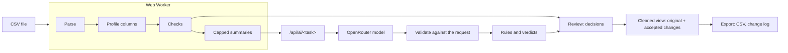
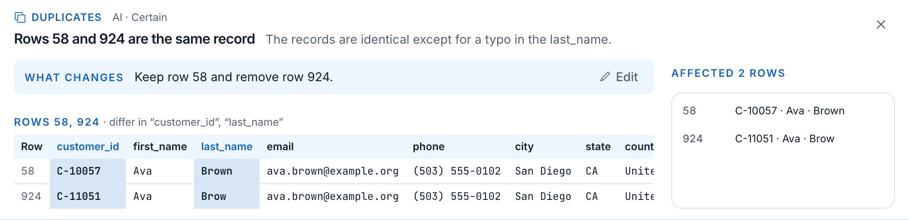

# AI Data Cleanup Assistant

**Live demo: [ai-data-cleanup-assistant.vercel.app](https://ai-data-cleanup-assistant.vercel.app/)**. Choose **Load sample data** to try it without a file of your own.

Upload a CSV. The app finds **duplicates, inconsistent values, missing data and suspicious records**, suggests a change wherever one is safe, and lets you accept, edit or reject each suggestion, and undo any step, before you export the cleaned file. Code checks the whole file; the AI reads summaries of it and proposes rules that code validates and applies. The original file is never modified, and nothing changes without your decision.

[Run it locally](#run-it-locally) · [How it works](#how-it-works) · [A tour of the code](#a-tour-of-the-code) · [The AI layer](#the-ai-layer) · [Accuracy](#accuracy) · [Decisions and trade-offs](#decisions-and-trade-offs)


<sub>The sample after one decision: the AI grouped “California” and “Calif.” under “CA”, and the cleaned grid shows the six cells that changed.</sub>

## The brief

> Create an application that you can upload a csv into. With the csv, the application should use AI to read through the data and identify duplicates, inconsistent values, missing data, or suspicious records. Then the application should suggest edits, and allow the user to review/accept these edits.

| The brief asks for           | How it is met                                                                                                                                                                                                                                                                                                             |
| ---------------------------- | ------------------------------------------------------------------------------------------------------------------------------------------------------------------------------------------------------------------------------------------------------------------------------------------------------------------------- |
| Upload a CSV                 | Drop or choose a file, up to 50 MB. Comma, semicolon, tab and pipe delimiters are detected; a file that is not UTF-8 is read as Windows-1252 and the screen says so. Parsing runs in a Web Worker ([`src/workers/dataset.worker.ts`](src/workers/dataset.worker.ts)).                                                     |
| AI reads through the data    | Three AI tasks ([`src/ai/tasks/`](src/ai/tasks/)) read distinct values with counts, candidate duplicate pairs, and flagged and sampled rows. A file smaller than a task's cap is sent whole.                                                                                                                              |
| Identify duplicates          | Checks find exact and normalized-equal rows and rows sharing an identifier. Code also pairs rows with near-identical names; the AI confirms those pairs and picks, per column, which row's value to keep.                                                                                                                 |
| Identify inconsistent values | Checks find whitespace and casing variants, mixed date formats and values of the wrong type. The AI groups spellings of one value (`CA`, `Calif.`, `California`) under one form.                                                                                                                                          |
| Identify missing data        | Checks find empty cells and common placeholders (`N/A`, `null`, `-`, `unknown`). The AI recognizes placeholders particular to the file (`no data`, `pending`).                                                                                                                                                            |
| Identify suspicious records  | Checks find robust outliers, invalid emails, formula-like values and structural problems (ragged rows, blank rows, empty or repeated headers). The AI reviews the flagged rows and a sample, explains each, and suggests a value only when it is unambiguous.                                                             |
| Suggest edits                | Most issues carry a suggestion expressed as data ([`src/engine/changes/change.ts`](src/engine/changes/change.ts)): what changes, why, how confident, and whether a check or the AI found it. Where no change is safe (a formula-like value, an invalid email, an outlier) the issue explains itself and can be dismissed. |
| Review and accept the edits  | Apply each suggestion with a button that names the change (“Trim spaces”, “Remove row 169”), edit it, or keep the data as is; decide a whole category at once; undo and redo any step; review from the keyboard. Export the cleaned CSV and a change log of every cell changed.                                           |

## Run it locally

Requires Node 24 and Corepack (it ships with Node and provides the pinned Yarn 4).

```bash
git clone https://github.com/leo-alfaro-dev/ai-data-cleanup-assistant.git
cd ai-data-cleanup-assistant
corepack enable
yarn install
yarn dev               # http://localhost:3000
```

Open the page and choose **Load sample data**, or drop any CSV.

**The AI is optional.** Without a key, checks, review and export work, and each AI task says that no key is set. To turn the AI on, copy `.env.example` to `.env.local` and set a development [OpenRouter key](https://openrouter.ai/keys):

```bash
cp .env.example .env.local
# OPENROUTER_API_KEY=sk-or-...   (server only; never prefix it with NEXT_PUBLIC_)
```

Every file you load then runs the AI tasks on that key. A run on the sample costs under one US cent on either offered model ([`eval/results/summary.md`](eval/results/summary.md)).

| Command                             | What it does                                                                                                      |
| ----------------------------------- | ----------------------------------------------------------------------------------------------------------------- |
| `yarn build && yarn start`          | Builds and serves the production app                                                                              |
| `yarn test`                         | Unit specs (Vitest)                                                                                               |
| `yarn integrations`                 | Production build and Playwright on port 3100, with the AI routes mocked. Once: `yarn playwright install chromium` |
| `yarn verify`                       | Format, spelling, key scan, lint, typecheck and unit specs: what CI runs before e2e                               |
| `yarn eval --checks-only`           | Scores the checks against the planted errors (free)                                                               |
| `yarn eval --models a,b --estimate` | Calls and cost ceiling for a benchmark of those OpenRouter models, with no call made                              |
| `yarn eval --models a,b`            | Benchmarks real models (spends money on your key)                                                                 |

## How it works



1. **The file stays in the browser.** One Web Worker reads it, profiles every column and runs 13 checks ([`src/engine/checks/`](src/engine/checks/)). Rows reach the page in chunks of 10,000, so the grid appears while the rest arrive, and check suggestions are reviewable as soon as the checks finish.
2. **The worker builds the AI requests** from the profile and the check results, capped by named constants in each task's contract (for example `MAX_VALUES_PER_REQUEST` in [`normalizeValuesContract.ts`](src/ai/tasks/normalizeValues/normalizeValuesContract.ts)). The page forwards them, three at a time, to thin route handlers ([`src/app/api/ai/`](src/app/api/ai/)) that call OpenRouter with a server-side key.
3. **The model proposes; code decides.** Each reply is requested as JSON with a schema and validated with the same Zod schema. Every row, column and value it cites must exist in the request, or the claim is dropped and counted. An invalid reply gets one retry, then the task fails with a reason ([`src/ai/runStructuredCompletion.ts`](src/ai/runStructuredCompletion.ts)).
4. **AI issues join the check issues as each task finishes.** An AI issue that covers a check issue absorbs it, so the same values never get two competing suggestions ([`src/engine/issues/mergeAiIssues.ts`](src/engine/issues/mergeAiIssues.ts)).
5. **Changes are pure functions of the original data.** No cleaned copy exists: the cleaned value of a cell is derived when it is read, from the original and the accepted decisions ([`src/engine/changes/compileCleanPlan.ts`](src/engine/changes/compileCleanPlan.ts)). Undo is flipping a decision, and the result does not depend on the order of decisions.
6. **Export is faithful.** The cleaned CSV keeps the input's header text, column order, delimiter and line breaks; with no accepted decisions it reproduces the input rows exactly. A Windows-1252 file is written as UTF-8 with a byte order mark, and the change log says so.

**Scale.** On the production build, a 17 MB file of 100,990 rows × 20 columns showed its first rows in 0.2 s and finished its checks in 2.5 s, and the page's main thread never stalled for more than 50 ms while the file loaded or while the grid scrolled to the last row (three runs, headless Chromium, Apple M4 Pro).

## A tour of the code

One Next.js app. Most of the logic is framework-free TypeScript in `src/engine/`, which imports nothing from React, Next or the browser (lint-enforced), so the worker, the unit specs and the benchmark run the same code.

| Folder                                               | What it holds                                                                                         |
| ---------------------------------------------------- | ----------------------------------------------------------------------------------------------------- |
| [`src/engine/`](src/engine/)                         | Parsing, profiling, the checks, duplicate matching, changes and the clean plan, export                |
| [`src/ai/`](src/ai/)                                 | The three AI tasks, the OpenRouter client, the structured-output runner, the rate limiter, the models |
| [`src/workers/`](src/workers/)                       | The one Web Worker that owns the parsed rows, and its lazy client                                     |
| [`src/features/workspace/`](src/features/workspace/) | The app's one screen: components, and the stores in `state/` that hold the review                     |
| [`src/app/`](src/app/)                               | Routes only: the page and three route handlers, `/api/ai/<task-name>`                                 |
| `src/components/`, `src/hooks/`, `src/lib/`          | Shared UI primitives, hooks and pure helpers                                                          |
| [`eval/`](eval/)                                     | Synthetic data with planted errors, the scorer, the model benchmark and its committed results         |
| [`e2e/`](e2e/)                                       | Playwright specs and AI replies recorded from a real model                                            |
| [`plan/`](plan/README.md)                            | The development plan: epics, tasks and how each was proven                                            |
| `docs/`                                              | README screenshots                                                                                    |

### Follow a file through the code

| Step     | What happens                                                                                                                                                                                                    | Start reading                                                                                                                                                                |
| -------- | --------------------------------------------------------------------------------------------------------------------------------------------------------------------------------------------------------------- | ---------------------------------------------------------------------------------------------------------------------------------------------------------------------------- |
| Load     | The page hands the `File` to the worker, which decodes it (strict UTF-8, else Windows-1252) and parses it with Papa Parse. Ragged rows and empty or repeated headers are kept and become issues, never dropped. | [`workspaceStore.ts`](src/features/workspace/state/workspaceStore.ts), [`dataset.worker.ts`](src/workers/dataset.worker.ts), [`parseCsv.ts`](src/engine/dataset/parseCsv.ts) |
| Profile  | Each column gets its dominant type, distinct values with counts, blanks, numeric spread (median and median absolute deviation) and date formats.                                                                | [`profileDataset.ts`](src/engine/profile/profileDataset.ts)                                                                                                                  |
| Check    | Every check is a pure function from dataset and profile to issues, one per file, registered in one list. Outliers use the modified z-score, on a log scale for right-skewed columns.                            | [`checks.ts`](src/engine/checks/checks.ts), [`toOutlierScale.ts`](src/engine/checks/toOutlierScale.ts)                                                                       |
| Match    | Near-duplicate candidates: rows sorted by name, each compared with the next 5 (Jaro-Winkler of at least 0.92 and agreement on another column), plus rows sharing an identifier. At most 300, strongest first.   | [`findNearDuplicateCandidates.ts`](src/engine/matching/findNearDuplicateCandidates.ts)                                                                                       |
| Ask      | The worker builds the capped requests; the page posts them with at most three in flight, and discards answers from a run that is no longer current.                                                             | [`dataset.worker.ts`](src/workers/dataset.worker.ts), [`runAiJobs.ts`](src/features/workspace/state/runAiJobs.ts)                                                            |
| Validate | The route parses the body with the task's contract, calls the model with a strict JSON schema, validates the reply, and drops every claim that cites something it was not sent.                                 | [`createAiRoute.ts`](src/ai/createAiRoute.ts), [`validateNormalizeValues.ts`](src/ai/tasks/normalizeValues/validateNormalizeValues.ts)                                       |
| Merge    | A validated reply becomes issues whose suggestions are changes expressed as data; an AI issue absorbs a check issue it covers.                                                                                  | [`toNormalizeValuesIssues.ts`](src/ai/tasks/normalizeValues/toNormalizeValuesIssues.ts), [`mergeAiIssues.ts`](src/engine/issues/mergeAiIssues.ts)                            |
| Review   | Decisions live in a map keyed by issue id, apart from the rows. Each action, single or bulk, is one batch on the undo stack.                                                                                    | [`reviewStore.ts`](src/features/workspace/state/reviewStore.ts), [`commitDecisions.ts`](src/features/workspace/state/commitDecisions.ts)                                     |
| Clean    | Accepted changes compile into a small plan; the grid and the export ask it for each cell's cleaned value, with an explicit precedence when two changes touch one cell.                                          | [`compileCleanPlan.ts`](src/engine/changes/compileCleanPlan.ts), [`cleanCell.ts`](src/engine/changes/cleanCell.ts)                                                           |
| Export   | The worker writes the cleaned CSV and the change log.                                                                                                                                                           | [`exportCleanedFiles.ts`](src/engine/export/exportCleanedFiles.ts)                                                                                                           |

### The core types

```ts
// src/engine/issues/issue.ts
type Issue = {
  id: IssueId;
  category: 'duplicate' | 'inconsistent' | 'missing' | 'suspicious';
  source: 'check' | 'ai';
  confidence: 'certain' | 'high' | 'medium' | 'low';
  rows: readonly RowId[];
  column: ColumnKey | null; // null: the issue covers whole rows
  suggestion: Change | null; // null: nothing is safe to change
  details: IssueDetails; // structured; the UI words it
};

// src/engine/changes/change.ts: a rule touches every row it matches
type Change = Rule | SetCells | MergeRows | RemoveRows;
type Rule = TrimWhitespace | MapValues | StandardizeDates | DropDuplicateRows;

// src/engine/decisions/decision.ts: an issue without one is pending
type Decision =
  | { status: 'accepted' }
  | { status: 'edited'; change: Change }
  | { status: 'rejected' };
```

Ids are branded types (`RowId`, `ColumnKey`, `IssueId`), so a row index can never be passed as a column. A row keeps its `RowId` from parsing for life, and columns are keyed by position, never by header text, because headers can be empty or repeated.

### Anatomy of an AI task

Each task is one folder in [`src/ai/tasks/`](src/ai/tasks/) with the same parts, named after the task:

| File                     | Role                                                                               |
| ------------------------ | ---------------------------------------------------------------------------------- |
| `<task>Contract.ts`      | Request and reply schemas (Zod) and the caps, shared by the browser and the server |
| `build<Task>Requests.ts` | Turns the profile and the check results into capped requests; runs in the worker   |
| `build<Task>Prompt.ts`   | A pure prompt builder, with a snapshot spec that holds the reviewed prompt         |
| `run<Task>.ts`           | Calls the model through an injected client, so specs pass a fake one               |
| `validate<Task>.ts`      | Keeps only the claims about rows, columns and values that were sent                |
| `to<Task>Issues.ts`      | Turns a validated reply into issues                                                |

### State

The page's state lives in `react-global-state-hooks` stores, one per concern, in [`src/features/workspace/state/`](src/features/workspace/state/). Async work runs in store actions started by a user event, each one readable top to bottom: `loadFile` cancels the previous worker call, loads the file, pulls the rows in chunks and starts the analysis. Each run has an id and an `AbortController`, so loading a new file stops the AI requests in flight and nothing from the old run lands.

## The AI layer

| AI task                      | Receives                                                                                                                  | Returns                                                                                      | Becomes                                                                                                |
| ---------------------------- | ------------------------------------------------------------------------------------------------------------------------- | -------------------------------------------------------------------------------------------- | ------------------------------------------------------------------------------------------------------ |
| Group spellings of one value | One text column's distinct values with counts: up to 200 values, up to 12 columns per file                                | Groups of spellings with a canonical form, and values that mean “no value”                   | A value mapping per group (Inconsistent values); one rule that empties the placeholders (Missing data) |
| Confirm duplicate rows       | The 30 strongest candidate pairs, with both rows' values                                                                  | Per pair: duplicate or not, why, which row to keep, and which row's value to keep per column | A merge of the two rows (Duplicates)                                                                   |
| Review suspicious rows       | Up to 40 rows the checks flagged and 40 sampled rows, with a summary of each column; every row of a file of up to 80 rows | Per row: suspicious or plausible, why, and a value only when it is unambiguous               | A note on the check issue that flagged the row, or an issue of its own (Suspicious records)            |



<sub>A pair the AI confirmed, with its reason. Code turns the verdict into a merge that can be edited before it is applied.</sub>

- **Summaries, not files.** No call per row or per value: calls per run scale with the column count and are capped (6 on the sample). A file smaller than a cap is sent whole, so small files are read in full.
- **Cell values are data, not instructions.** Prompts put them inside a delimited data block and say so. Each prompt builder has a reviewed snapshot ([normalize values](src/ai/tasks/normalizeValues/__snapshots__/), [duplicates](src/ai/tasks/confirmDuplicates/__snapshots__/), [suspicious rows](src/ai/tasks/assessSuspiciousRows/__snapshots__/)).
- **Model output is untrusted.** The reply is requested with a strict JSON schema built from the same Zod schema that validates it. Claims that cite a row, column or value that was not sent are left out and counted; in the recorded sample run, 2 of the model's 236 claims were left out.
- **Confidence is a sort key, not a score.** The model's confidence orders the suggestions and reads as Certain, Very sure, Fairly sure or Unsure, never as a percentage. Bulk apply can stop at any level.
- **Failures carry a reason.** Each task fails with one of a fixed set of reasons (no key, rejected key, rate limit, budget used up, timeout, invalid output and others), worded once for the UI; the provider's message never reaches the browser, and the checks keep working.
- **Server-only key.** Only [`openRouterClient.ts`](src/ai/openRouterClient.ts) imports the `openai` SDK, and it imports `server-only`, so the hosted key cannot reach the browser bundle.

## What is different

- **Rules, not edits.** The model never rewrites the file. It proposes rules (“these spellings are one state”), and one decision applies a rule to every row it touches. Every change is explainable, reversible and repeatable.
- **Measured accuracy.** Errors are planted in synthetic data and recorded, so the checks and each model are scored per category against known truth, with cost and latency ([`eval/`](eval/)).
- **Review at volume.** Apply a category's suggestions in one step: only the certain ones, the certain and very sure ones, or all of them, or keep them all as is. J and K move, A applies, R keeps as is, E edits, U undoes, Shift+U redoes, O switches the grid between original and cleaned, G shows the issue's first row, and ? lists every shortcut.
- **Nothing hidden.** The header shows AI calls, tokens and cost; one click opens every request exactly as the browser sent it, with each call's model, tokens, cost and latency.


<sub>The request for the “state” column: its distinct values with counts, not its rows.</sub>

## Accuracy

Errors are planted in a synthetic customer file (1,150 rows, seed 20250601) and recorded, so each run is scored against known truth. Precision is how many claims were right; recall is how many planted errors were found; suggestion accuracy is how often the suggested value equals the clean value. Numbers come from [`eval/results/`](eval/results/), written by `yarn eval`, on 2026-11-15. Each model ran the file once.

| Run                            | Duplicates          | Inconsistent values | Missing data        | Suspicious records  | Suggestion accuracy | Cost per run | Time per run |
| ------------------------------ | ------------------- | ------------------- | ------------------- | ------------------- | ------------------- | ------------ | ------------ |
| Checks only                    | P 100.0% · R 100.0% | P 100.0% · R 69.2%  | P 100.0% · R 100.0% | P 100.0% · R 100.0% | 100.0%              | $0           | n/a          |
| `anthropic/claude-haiku-5.5`   | P 100.0% · R 100.0% | P 100.0% · R 100.0% | P 100.0% · R 100.0% | P 100.0% · R 100.0% | 90.1%               | $0.0094      | 34.3 s       |
| `google/gemini-2.5-flash-lite` | P 100.0% · R 100.0% | P 100.0% · R 100.0% | P 100.0% · R 100.0% | P 100.0% · R 100.0% | 100.0%              | $0.0090      | 19.4 s       |
| `openai/gpt-5-mini`            | P 100.0% · R 100.0% | P 12.5% · R 86.2%   | P 100.0% · R 100.0% | P 100.0% · R 100.0% | 24.2%               | ≥ $0.0214    | 71.3 s       |

P is precision and R is recall. The full table, with calls, tokens and failed tasks, is in [`eval/results/summary.md`](eval/results/summary.md).

- **What the AI adds.** The checks alone find every planted duplicate, missing value and suspicious record on this file. The AI raises recall of inconsistent values from 69.2% to 100% by grouping spellings the checks cannot (`Calif.`, `California`).
- **Default model.** Gemini 2.5 Flash Lite. The rule: among the offered models with precision of at least 90% in every category, the highest recall (planted errors found over planted errors, all categories together); a tie goes to the higher suggestion accuracy, then the lower cost. Gemini and Claude Haiku 5.5 tie on recall at 100%, so suggestion accuracy (100.0% against 90.1%) decides it; Gemini's cost is also about 5% lower, which one run cannot separate from noise. One of Gemini's calls returned invalid output and was retried once.
- **Duplicate suggestions** are scored by the row a merge removes: it is right when that row is the planted copy. Of Haiku's 150 removals, 120 were planted copies and 30 were not; every removal the checks make is right, so the 30 come from the pairs the AI confirmed. The result files do not keep the replies, so the cause is not known.
- **GPT-5 mini** flagged 899 cells as inconsistent, 112 of them planted errors, and its suspicious-rows request timed out after 55 seconds, so it is not offered. Its cost is a lower bound: the timed-out call returned no usage.
- **Limits.** One run per model on one synthetic file that is also the demo sample, and the checks were built against the kinds of errors planted in it. A real file will score lower. Model answers vary between runs: in the run recorded for the e2e tests and the screenshots, the default model also called “United States” a possible placeholder, at the lowest confidence. Such a suggestion sorts last in its category, only the “All of them” bulk option includes it, and it changes nothing until someone applies it.

## Privacy and limits

- **What leaves the browser:** only the AI requests. The AI tasks start on their own once the checks finish. They hold distinct values with counts (at most 200 per column, 12 columns), the 30 strongest candidate duplicate pairs with both rows' values, and up to 40 flagged and 40 sampled rows with the 5 most common values of each column. The transparency panel shows each one exactly as sent. The file itself is never uploaded.
- **Logs carry metadata only:** task, model, tokens, cost, latency and outcome; never prompts, cell values or keys ([`src/ai/logAiCall.ts`](src/ai/logAiCall.ts)).
- **Your own key.** **Add your key** accepts an OpenRouter key. It is kept in memory, or in `sessionStorage` to survive a refresh, sent per request in a header, used for that call only, and never stored or logged on the server.
- **Demo limits.** The hosted demo spends from one OpenRouter key with a credit limit. A visitor gets 50 AI requests per 10 minutes on that key ([`src/ai/hostedRequestLimit.ts`](src/ai/hostedRequestLimit.ts)), counted per server instance, so the limit is best effort. The AI tasks window shows how many are used and when the count resets; `yarn dev` counts them without refusing any. A full run on the sample is 6 requests. The benchmark run on Gemini 2.5 Flash Lite made 7 model calls (one reply was retried), 40,010 tokens, $0.0090 ([`eval/results/google--gemini-2.5-flash-lite.json`](eval/results/google--gemini-2.5-flash-lite.json)); the run in the screenshots, recorded from the same model, made 6 calls, 24.0k tokens, $0.005. At the higher cost each $5 of credit covers about 550 runs.
- **When the AI is unavailable** (no key, a rejected key, the rate limit, the budget used up), the checks keep working, each AI task says why it failed and offers a retry, and the limit and budget messages offer your own key.

## Tests and CI

- **Unit specs** sit beside the code: 2,277 tests in 220 files covering the engine, every check (fed small inline CSVs, from both sides: what it must find and what it must leave alone), the AI runners with a fake client, prompt snapshots, and the UI in jsdom. A race spec holds an AI response, loads a new file, releases the response and asserts that nothing from the old run lands.
- **End-to-end tests** (32, Playwright) run on the production build, because a Web Worker setup can work in development and hang in production. The AI routes are mocked with replies recorded from a real model, so the suite is offline and free, and the test server has no key, so a route that escaped its mock cannot spend money.
- **CI** ([`.github/workflows/ci.yml`](.github/workflows/ci.yml)) runs format, spelling, key scan, lint, typecheck, unit tests and the e2e suite on every push to `main` and `development` and on pull requests. The benchmark is not run in CI, since it calls real models.

## Decisions and trade-offs

- **Checks first, AI second.** Code covers the whole file for free and at once; the AI adds what code cannot judge (spellings, which duplicate value to keep, whether a flagged row is plausible). The app works without the AI.
- **The browser does the heavy work.** Parsing and checks in a Web Worker mean no upload, no storage and nothing to scale on the server; the cost is that the visitor's device bounds the file, which is capped at 50 MB.
- **Summaries, not files.** Sending distinct values and capped samples keeps cost flat as files grow, at the price of the model seeing only the most common 200 values of a column in a large file.
- **Changes never feed each other.** This makes results independent of decision order, but a duplicate that only appears after normalizing values is not found in the same pass.
- **The original is never modified,** and the cleaned value is derived on read, so undo costs nothing and 100,000 rows need no second copy.
- **Ambiguity goes to the user.** `03/04/2024` is flagged, not converted, and neither checks nor the AI invent a missing name, email or number.
- **Best-effort rate limit.** The limiter counts per server instance; the credit limit on the key is the hard cap.
- **Deliberately not built:** accounts, a database or any persistence beyond the tab, Excel files, multi-file joins, collaboration, and free-form cell editing (every change is a suggestion). Each would add surface without serving the brief in a one-day build.

## What comes next

- **The production shape for large files and teams:** uploads to object storage, parsing and checks in a queue with workers instead of the browser, and a database for decisions and an audit trail of who accepted what.
- **From [`plan/stretch.md`](plan/stretch.md):** a second pass that re-runs the checks on the cleaned data; column dependencies (fill a missing city from its zip, flag contradictions); a one-call dataset summary shown on screen and given to the other AI tasks; number-format standardization; a one-click 100,000-row sample; a dark theme; signing in with OpenRouter instead of pasting a key.
