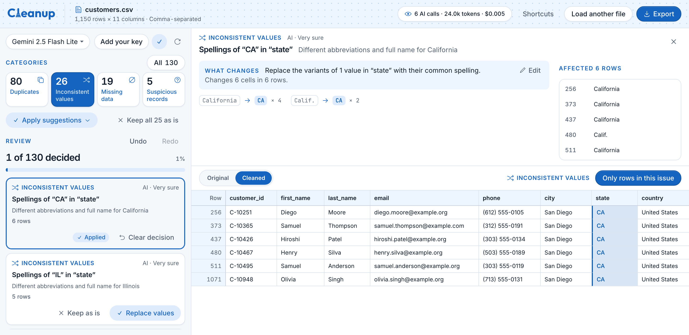
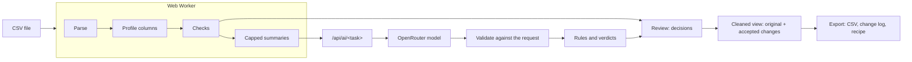
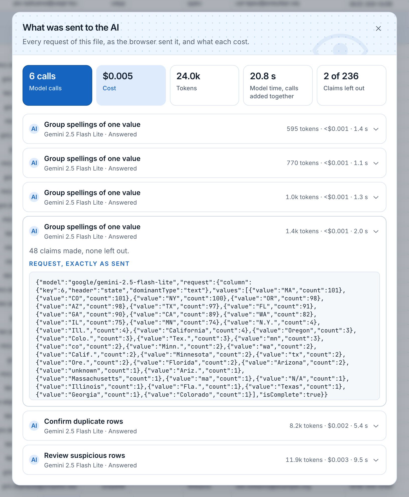

# AI Data Cleanup Assistant

Upload a CSV. The app finds **duplicates, inconsistent values, missing data and suspicious records**, suggests a change wherever one is safe, and lets you apply, edit or decline every suggestion, and undo any step, before you export the cleaned file. Code checks the whole file; the AI reads summaries of it and proposes rules that code validates and applies. The original file is never modified, and nothing changes without your decision.

**Live demo:** https://ai-data-cleanup-assistant.vercel.app. Choose **Load sample data** to try it without a file of your own.



## The brief

> Create an application that you can upload a csv into. With the csv, the application should use AI to read through the data and identify duplicates, inconsistent values, missing data, or suspicious records. Then the application should suggest edits, and allow the user to review/accept these edits.

| The brief asks for           | How it is met                                                                                                                                                                                                                                                                                                             |
| ---------------------------- | ------------------------------------------------------------------------------------------------------------------------------------------------------------------------------------------------------------------------------------------------------------------------------------------------------------------------- |
| Upload a CSV                 | Drop or choose a file, up to 50 MB. Comma, semicolon, tab and pipe delimiters are detected; a file that is not UTF-8 is read as Windows-1252 and the screen says so. Parsing runs in a Web Worker ([`src/workers/dataset.worker.ts`](src/workers/dataset.worker.ts)).                                                     |
| AI reads through the data    | Three AI tasks ([`src/ai/tasks/`](src/ai/tasks/)) read distinct values with counts, candidate duplicate pairs, and flagged and sampled rows. A file smaller than a task's cap is sent whole.                                                                                                                              |
| Identify duplicates          | Checks find exact and normalized-equal rows and rows sharing an identifier. Code also pairs rows with near-identical names; the AI confirms those pairs and picks, per column, which row's value to keep.                                                                                                                 |
| Identify inconsistent values | Checks find whitespace and casing variants, mixed date formats and values of the wrong type. The AI groups spellings of one value (`CA`, `Calif.`, `California`) under one form.                                                                                                                                          |
| Identify missing data        | Checks find empty cells and common placeholders (`N/A`, `null`, `-`, `unknown`). The AI recognizes placeholders particular to the file (`no data`, `pending`).                                                                                                                                                            |
| Identify suspicious records  | Checks find robust outliers, invalid emails, formula-like values and structural problems (ragged rows, repeated headers). The AI reviews the flagged rows and a sample, explains each, and suggests a value only when it is unambiguous.                                                                                  |
| Suggest edits                | Most issues carry a suggestion expressed as data ([`src/engine/changes/change.ts`](src/engine/changes/change.ts)): what changes, why, how confident, and whether a check or the AI found it. Where no change is safe (a formula-like value, an invalid email, an outlier) the issue explains itself and can be dismissed. |
| Review and accept the edits  | Apply each suggestion with a button that names the change (“Trim spaces”, “Remove row 169”), edit it, or keep the data as is; decide a whole category at once; undo and redo any step; review from the keyboard. Export the cleaned CSV, a change log of every cell changed, and a recipe of the applied rules.           |

## How it works



1. **The file stays in the browser.** One Web Worker parses it, profiles every column and runs the checks ([`src/engine/checks/`](src/engine/checks/)), so a 100,000-row file never blocks the page. Check suggestions are reviewable at once.
2. **The worker builds the AI requests** from the profile and the check results, capped by named constants in each task's contract (for example `MAX_VALUES_PER_REQUEST` in [`normalizeValuesContract.ts`](src/ai/tasks/normalizeValues/normalizeValuesContract.ts)). The page forwards them to thin route handlers ([`src/app/api/ai/`](src/app/api/ai/)) that call OpenRouter with a server-side key.
3. **The model proposes; code decides.** Each reply is requested as JSON with a schema and validated with the same Zod schema. Every row, column and value it cites must exist in the request, or the claim is dropped and counted. An invalid reply gets one retry, then the task fails with a reason ([`src/ai/runStructuredCompletion.ts`](src/ai/runStructuredCompletion.ts)).
4. **Changes are pure functions of the original data.** No cleaned copy exists: the cleaned value of a cell is derived when it is read, from the original and the accepted decisions ([`src/engine/changes/compileCleanPlan.ts`](src/engine/changes/compileCleanPlan.ts)). Undo is flipping a decision, the result does not depend on the order of decisions, and a recipe replays identically.

## What is different

- **Rules, not edits.** The model never rewrites the file. It proposes rules ("these spellings are one state"), and one decision applies a rule to every row it touches. Every change is explainable, reversible and repeatable.
- **A recipe.** Accepted rules export as versioned JSON keyed by column header. Replaying it cleans next month's file in one step with zero AI calls, and reports any rule it had to skip ([`src/engine/recipe/`](src/engine/recipe/)). The sample includes next month's file to try it on.
- **Measured accuracy.** Errors are planted in synthetic data and recorded, so the checks and each model are scored per category against known truth, with cost and latency ([`eval/`](eval/)).
- **Review at volume.** Apply a category's suggestions in one step: only the certain ones, the certain and very sure ones, or all of them. J and K move, A applies, R keeps as is, E edits, U undoes, Shift+U redoes, O switches the grid between original and cleaned, and ? lists every shortcut.
- **Nothing hidden.** The header shows AI calls, tokens and cost; one click opens every request exactly as the browser sent it, with each call's model, tokens, cost and latency.



## Accuracy

Errors are planted in a synthetic customer file (1,150 rows, seed 20250601) and recorded, so each run is scored against known truth. Precision is how many claims were right; recall is how many planted errors were found; suggestion accuracy is how often the suggested value equals the clean value. Numbers come from [`eval/results/`](eval/results/), written by `yarn eval`, on 2026-11-15. Each model ran the file once.

| Run                            | Duplicates          | Inconsistent values | Missing data        | Suspicious records  | Suggestion accuracy | Cost per run | Time per run |
| ------------------------------ | ------------------- | ------------------- | ------------------- | ------------------- | ------------------- | ------------ | ------------ |
| Checks only                    | P 100.0% · R 100.0% | P 100.0% · R 69.2%  | P 100.0% · R 100.0% | P 100.0% · R 100.0% | 100.0%              | $0           | n/a          |
| `anthropic/claude-haiku-5.5`   | P 100.0% · R 100.0% | P 100.0% · R 100.0% | P 100.0% · R 100.0% | P 100.0% · R 100.0% | 90.1%               | $0.0094      | 34.3 s       |
| `google/gemini-2.5-flash-lite` | P 100.0% · R 100.0% | P 100.0% · R 100.0% | P 100.0% · R 100.0% | P 100.0% · R 100.0% | 100.0%              | $0.0090      | 19.4 s       |
| `openai/gpt-5-mini`            | P 100.0% · R 100.0% | P 12.5% · R 86.2%   | P 100.0% · R 100.0% | P 100.0% · R 100.0% | 24.2%               | ≥ $0.0214    | 71.3 s       |

P is precision and R is recall. The full table, with calls, tokens and failed tasks, is in [`eval/results/summary.md`](eval/results/summary.md).

- **What the AI adds.** The checks alone find every planted duplicate, missing value and suspicious record on this file. The AI raises recall of inconsistent values from 69.2% to 100% by grouping spellings the checks cannot (`Calif.`, `California`).
- **Default model.** Gemini 2.5 Flash Lite. The rule: among the offered models with precision of at least 90% in every category, the highest recall (planted errors found over planted errors, all categories together); a tie goes to the higher suggestion accuracy, then the lower cost. Gemini and Claude Haiku 5.5 tie on recall at 100%, so suggestion accuracy (100.0% against 90.1%) decides it; Gemini's cost is also about 5% lower, which one run cannot separate from noise. One of Gemini's calls returned invalid output and was retried once.
- **Duplicate suggestions** are scored by the row a merge removes: it is right when that row is the planted copy. Of Haiku's 150 removals, 120 were planted copies and 30 were not; every removal the checks make is right, so the 30 come from the pairs the AI confirmed. The result files do not keep the replies, so the cause is not known.
- **GPT-5 mini** flagged 899 cells as inconsistent, 112 of them planted errors, and its suspicious-rows request timed out after 55 seconds, so it is not offered. Its cost is a lower bound: the timed-out call returned no usage.
- **Limits.** One run per model on one synthetic file that is also the demo sample, and the checks were built against the kinds of errors planted in it. A real file will score lower; model answers vary between runs, so small differences are not a ranking.

## Privacy and limits

- **What leaves the browser:** only the AI requests. The AI tasks start on their own once the checks finish (not when a recipe is replayed). They hold distinct values with counts (at most 200 per column, 12 columns), up to 300 candidate duplicate pairs in requests of 30 with both rows' values, and up to 40 flagged and 40 sampled rows with the 5 most common values of each column. The transparency panel shows each one exactly as sent. The file itself is never uploaded.
- **Cell values are data, not instructions.** Prompts put them inside a delimited data block and say so ([snapshots](src/ai/tasks/normalizeValues/__snapshots__/)).
- **Logs carry metadata only:** task, model, tokens, latency and outcome; never prompts, cell values or keys ([`src/ai/logAiCall.ts`](src/ai/logAiCall.ts)).
- **Your own key.** **Add your key** accepts an OpenRouter key. It is kept in memory, or in `sessionStorage` to survive a refresh, sent per request in a header, used for that call only, and never stored or logged on the server.
- **Demo limits.** The hosted demo spends from one OpenRouter key with a credit limit. A visitor gets 50 AI requests per 10 minutes on that key ([`src/ai/hostedRequestLimit.ts`](src/ai/hostedRequestLimit.ts)), counted per server instance, so the limit is best effort. The AI tasks window shows how many are used and when the count resets; `yarn dev` counts them without refusing any. A full run on the sample is 6 requests. The benchmark run on Gemini 2.5 Flash Lite made 7 model calls (one reply was retried), 40,010 tokens, $0.0090 ([`eval/results/google--gemini-2.5-flash-lite.json`](eval/results/google--gemini-2.5-flash-lite.json)); the run in the screenshots made 6 calls, 24.0k tokens, $0.005. At the higher cost each $5 of credit covers about 550 runs.
- **When the AI is unavailable** (no key, a rejected key, the rate limit, the budget used up), the checks keep working, each AI task says why it failed and offers a retry, and the limit and budget messages offer your own key.

## Run it locally

Requires Node 24 and Corepack (for the pinned Yarn 4).

```bash
corepack enable
yarn install
yarn dev               # http://localhost:3000
```

**Without a key** the app works without the AI: checks, review, export and recipes work, and the AI tasks report that no key is set.

**With a key**, copy `.env.example` to `.env.local` and set a development OpenRouter key:

```bash
cp .env.example .env.local
# OPENROUTER_API_KEY=sk-or-...   (server only; never prefix it with NEXT_PUBLIC_)
```

`yarn build && yarn start` serves the production build.

## Tests and CI

```bash
yarn verify                  # Format, spellcheck, key scan, lint, typecheck, unit tests
yarn integrations            # Production build + Playwright, with the AI routes mocked
yarn eval --checks-only      # Score the checks against the planted errors (free)
yarn eval --models a,b --estimate   # Calls and cost ceiling for a benchmark, with no call made
yarn eval --models a,b       # Benchmark real models (costs money)
```

- **Unit specs** sit beside the code: the engine, every check (fed small inline CSVs, from both sides: what it must find and what it must leave alone), the AI runners with a fake client, prompt snapshots, and the UI in jsdom.
- **End-to-end tests** run on the production build, because a Web Worker setup can work in development and hang in production. The AI routes are mocked with replies recorded from a real model, so the suite is offline and free, and the test server has no key, so a route that escaped its mock cannot spend money.
- **CI** ([`.github/workflows/ci.yml`](.github/workflows/ci.yml)) runs format, spelling, key scan, lint, typecheck, unit tests and the e2e suite on every push to `main` and `development` and on pull requests. The benchmark is not run in CI.

## Project structure

```
src/
  app/                  Routes only: the page and /api/ai/<task-name>
  engine/               Framework-free TypeScript: parse, profile, checks, matching, changes, recipe, export
  ai/                   Contracts, prompts, task runners, the OpenRouter client, the model list
  workers/              The dataset worker and its client
  features/workspace/   The one screen: upload, grid, review, export, transparency
  components/ hooks/ lib/   Shared UI, hooks and pure helpers
eval/                   Seeded datasets with planted errors, the scorer, the benchmark and its results
e2e/                    Playwright specs and recorded AI replies
plan/                   The development plan: epics, tasks and how each is proven
docs/                   README images, demo script, submission checklist
```

The engine imports nothing from React, Next or the browser, so the worker, the specs and the benchmark run the same code.

## Decisions and trade-offs

- **Checks first, AI second.** Code covers the whole file for free and at once; the AI adds what code cannot judge (spellings, which duplicate value to keep, whether a flagged row is plausible). The app works without the AI.
- **Summaries, not files.** Sending distinct values and capped samples keeps cost flat as files grow, at the price of the model seeing only the most common 200 values of a column in a large file.
- **Changes never feed each other.** This makes results independent of decision order and recipes exact, but a duplicate that only appears after normalizing values is not found in the same pass.
- **The original is never modified,** and the cleaned value is derived on read, so undo costs nothing and 100,000 rows need no second copy.
- **Ambiguity goes to the user.** `03/04/2024` is flagged, not converted, and neither checks nor the AI invent a missing name, email or number.
- **Best-effort rate limit.** The limiter counts per server instance; the credit limit on the key is the hard cap.
- **Deliberately not built:** accounts, a database or any persistence beyond the tab, Excel files, multi-file joins, collaboration, and free-form cell editing (every change is a suggestion). Each would add surface without serving the brief in a one-day build.

## What comes next

- **The production shape for large files and teams:** uploads to object storage, parsing and checks in a queue with workers instead of the browser, and a database for recipes, decisions and an audit trail of who accepted what.
- **From [`plan/stretch.md`](plan/stretch.md):** a second pass that re-runs the checks on the cleaned data; column dependencies (fill a missing city from its zip, flag contradictions); a one-call dataset summary shown on screen and given to the other AI tasks; number-format standardization; a one-click 100,000-row sample; a dark theme; signing in with OpenRouter instead of pasting a key.
